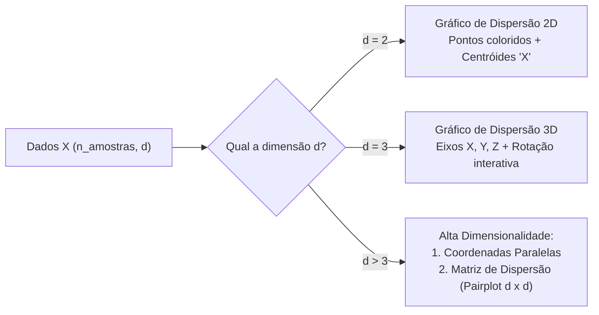

# CluIDs — Algoritmo K-Means do Zero em Python

<p align="center">
  
  
  
  
  
  
</p>

Implementação completa, didática e de alto desempenho do algoritmo de agrupamento (*clustering*) **K-Means**, desenvolvida **do zero** em Python utilizando exclusivamente **NumPy** para operações matemáticas vetoriais e **Matplotlib** para renderização gráfica.

O projeto conta com inicialização inteligente **K-Means++**, critério de múltiplos reinícios (`n_init`), métricas e heurísticas para seleção do número ideal de grupos (como o **Método do Cotovelo / Elbow Method** e o **Coeficiente de Silhueta**) e um sistema adaptativo de visualização gráfica para dados em **2D**, **3D** e **alta dimensionalidade** (Coordenadas Paralelas e Matriz de Dispersão / *Pairplot*).

---

## 📑 Sumário

- [Sobre o Projeto](#-sobre-o-projeto)
- [Funcionalidades Principais](#-funcionalidades-principais)
- [Estrutura do Repositório](#-estrutura-do-repositório)
- [Requisitos e Instalação](#-requisitos-e-instalação)
- [Como Usar](#-como-usar)
  - [1. Execução Rápida via Script Principal](#1-execução-rápida-via-script-principal)
  - [2. Parâmetros Gerais do Projeto](#2-parâmetros-gerais-do-projeto)
  - [3. Utilizando como Módulo em Seu Próprio Código](#3-utilizando-como-módulo-em-seu-próprio-código)
- [Visualizações Gráficas Adaptativas](#-visualizações-gráficas-adaptativas)
- [Conjuntos de Dados (Datasets)](#-conjuntos-de-dados-datasets)
  - [Formato dos Arquivos](#formato-dos-arquivos)
  - [Bases Sintéticas e Desafios Clássicos](#bases-sintéticas-e-desafios-clássicos)
- [Fundamentação Teórica e Fórmulas](#-fundamentação-teórica-e-fórmulas)
- [Autoria e Créditos Acadêmicos](#-autoria-e-créditos-acadêmicos)
- [Licença](#-licença)

---

## 🔬 Sobre o Projeto

Este repositório é fruto de pesquisa de Iniciação Científica desenvolvida no âmbito do programa **PIBIC/CNPq** na **Universidade do Estado do Rio Grande do Norte (UERN)**, Departamento de Ciências Exatas e Naturais (FANAT), no curso de **Ciência da Computação**.

* **Título do Projeto:** CluIDs — Agrupamento de Instâncias Baseados em Centróides
* **Pesquisador:** Antonio Carlos Monteiro Silva
* **Orientador:** Prof. Dr. Marcelino Pereira dos Santos Silva
* **Fomento:** Conselho Nacional de Desenvolvimento Científico e Tecnológico (CNPq)

O desafio central do projeto é demonstrar como o algoritmo de agrupamento baseado em centróides pode ser implementado de maneira transparente e matematicamente rigorosa, sem depender de "caixas pretas" ou frameworks prontos de aprendizado de máquina (como o `scikit-learn`), atingindo confiabilidade e robustez equivalentes às implementações consagradas da literatura.

---

## 🚀 Funcionalidades Principais

* **K-Means Puro e Vetorizado:** Implementação completa do algoritmo de Lloyd utilizando operações matriciais eficientes do NumPy.
* **Inicialização K-Means++:** Seleção probabilística dos centróides iniciais ponderada pela distância quadrada $D(x)^2$, acelerando a convergência e evitando mínimos locais desfavoráveis.
* **Múltiplos Reinícios (`n_init`):** Executa o algoritmo $N$ vezes com diferentes sementes do K-Means++ e seleciona automaticamente a solução com menor inércia (WCSS).
* **Heurísticas para Escolha do $k$ Ideal:**
  * **Método do Cotovelo (Elbow Method):** Avaliação da inércia em função do número de clusters $k$.
  * **Coeficiente de Silhueta Médio:** Avaliação da coesão interna e separação entre clusters com matriz de distâncias $O(N^2)$ pré-computada e reutilizada para máxima performance.
* **Suporte Multi-Dimensional:**
  * **2D:** Gráficos de dispersão convencionais com centróides em destaque.
  * **3D:** Gráficos tridimensionais rotacionáveis com visualização em perspectiva.
  * **Alta Dimensionalidade ($d > 3$):** Visualização simultânea através de **Coordenadas Paralelas** (perfil de atributos por ponto e curvas centrais dos centróides) e **Matriz de Dispersão (*Pairplot*)** cruzando todas as combinações de atributos duas a duas.
* **Carregamento Automático:** Leitor flexível em `data_loader.py` capaz de identificar automaticamente a presença ou ausência de cabeçalho em arquivos `.csv` e `.txt`.

---

## 📂 Estrutura do Repositório

```text
algoritmo_kmeans/
├── datasets/          # Coleção de bases sintéticas e dados reais de teste
├── data_loader.py     # Função para leitura e parsing flexível de dados tabulares
├── kmeans.py          # Núcleo algorítmico do K-Means, K-Means++, Inércia e Silhueta
├── LICENSE            # Termos da Licença MIT
├── main.py            # Ponto de entrada: configuração de parâmetros e renderização gráfica
├── PESQUISA.md        # Documento científico com contexto detalhado e referências do PIBIC
└── README.md          # Documentação geral de instalação, uso e boas práticas
```

---

## ⚙️ Requisitos e Instalação

### Pré-requisitos
* **Python**: versão `3.8` ou superior (recomendado `3.10`+).
* **Tkinter**: pacote gráfico do sistema operacional para o backend `TkAgg` do Matplotlib (geralmente já incluso no Python padrão do Windows e macOS; no Linux Ubuntu/Debian pode ser instalado via `sudo apt install python3-tk`).

### Passo a Passo de Instalação

1. **Clone o repositório:**
   ```bash
   git clone https://github.com/seu-usuario/algoritmo_kmeans.git
   cd algoritmo_kmeans
   ```

2. **Crie e ative um ambiente virtual:**
   ```bash
   # Linux / macOS:
   python3 -m venv .venv
   source .venv/bin/activate

   # Windows:
   python -m venv .venv
   .venv\Scripts\activate
   ```

3. **Instale as dependências permitidas:**
   ```bash
   pip install numpy matplotlib
   ```

> [!NOTE]
> Em conformidade com as diretrizes do projeto, não são utilizadas bibliotecas como `scikit-learn` ou `pandas` para a lógica de agrupamento ou pré-processamento. Apenas `numpy` e `matplotlib` são necessários.

---

## 📖 Como Usar

### 1. Execução Rápida via Script Principal

Para executar o agrupamento com os parâmetros configurados atualmente e abrir as janelas gráficas, basta rodar:

```bash
python main.py
```

O script carregará a base de dados configurada, executará o K-Means, calculará as métricas de diagnóstico selecionadas e abrirá as janelas interativas do Matplotlib.

---

### 2. Parâmetros Gerais do Projeto

No arquivo [`main.py`](file:///home/lacum/Documentos/PIBIC/algoritmo_kmeans/main.py), os parâmetros de controle estão declarados de forma centralizada logo nas primeiras linhas. Você pode alterar qualquer um deles diretamente:

| Parâmetro | Tipo | Padrão | Descrição |
| :--- | :---: | :---: | :--- |
| `caminho_dataset` | `str` | `"datasets/05_cascas_esfericas_3d_concentricas.csv"` | Caminho relativo ou absoluto do arquivo de dados a ser agrupado. |
| `k` | `int` | `2` | Quantidade de clusters a serem formados pelo K-Means. |
| `N_INIT` | `int` | `10` | Quantidade de vezes que o K-Means será executado do zero (cada vez com nova semente K-Means++). O algoritmo reterá o modelo com menor inércia. |
| `MOSTRAR_ELBOW` | `bool` | `True` | Se `True`, executa o Método do Cotovelo e gera a janela com o gráfico de Inércia vs. $k$. |
| `K_ELBOW_MIN` | `int` | `2` | Menor valor de $k$ testado na curva do cotovelo. |
| `K_ELBOW_MAX` | `int` | `10` | Maior valor de $k$ testado na curva do cotovelo. |
| `MOSTRAR_SILHUETA` | `bool` | `True` | Se `True`, calcula o Coeficiente de Silhueta médio e exibe o gráfico para cada $k$. |
| `K_SILHUETA_MIN` | `int` | `2` | Menor valor de $k$ testado no cálculo da silhueta. |
| `K_SILHUETA_MAX` | `int` | `10` | Maior valor de $k$ testado no cálculo da silhueta. |

#### Exemplo de Configuração em `main.py`:
```python
# Ativa ou desativa os métodos de escolha do k ideal
MOSTRAR_ELBOW = True
MOSTRAR_SILHUETA = True

# Faixas de avaliação
K_ELBOW_MIN = 2
K_ELBOW_MAX = 8

K_SILHUETA_MIN = 2
K_SILHUETA_MAX = 8

N_INIT = 15

# Carregamento do dataset e chamada do algoritmo
X, features = carregar_dataset("datasets/01_blobs_bem_separados.csv")
centroides, clusters, labels = k_means(X, k=4, n_init=N_INIT)
```

---

### 3. Utilizando como Módulo em Seu Próprio Código

Você pode importar e utilizar as funções diretamente em outros scripts Python:

```python
from data_loader import carregar_dataset
from kmeans import k_means, calcular_elbow, calcular_silhueta_por_k

# 1. Carregar os dados
X, features = carregar_dataset("datasets/01_blobs_bem_separados.csv")
print(f"Instâncias: {X.shape[0]} | Atributos: {X.shape[1]}")
print(f"Features identificadas: {features}")

# 2. Executar o K-Means
k = 4
centroides, clusters, labels = k_means(X, k=k, n_init=10)

print(f"Coordenadas dos Centróides:\n{centroides}")
print(f"Rótulo atribuído à primeira instância: Cluster {labels[0]}")

# 3. Analisar métricas para seleção de k
ks, inercias = calcular_elbow(X, k_min=2, k_max=6, n_init=5)
print(f"Valores de k avaliados: {ks}")
print(f"Inércias correspondentes: {inercias}")
```

#### Assinatura das Funções Principais:

* `carregar_dataset(caminho: str) -> (np.ndarray, list[str])`
  * Retorna matriz `X` de dimensões `(n_amostras, n_features)` e lista com os nomes das colunas (ou lista vazia se não houver cabeçalho).
* `k_means(X: np.ndarray, k: int, n_init: int = 10) -> (np.ndarray, list[list], np.ndarray)`
  * Retorna `(centroides, clusters, labels)` correspondentes à melhor execução dentre os `n_init` sorteios.
* `calcular_inercia(centroides: np.ndarray, clusters: list[list]) -> float`
  * Retorna o WCSS total dos clusters.
* `calcular_elbow(X: np.ndarray, k_min: int = 2, k_max: int = 10, n_init: int = 10) -> (list[int], list[float])`
  * Retorna a lista de valores `ks` e a lista de `inercias` para traçar a curva do cotovelo.
* `calcular_silhueta_por_k(X: np.ndarray, k_min: int = 2, k_max: int = 10, n_init: int = 10) -> (list[int], list[float])`
  * Retorna a lista de valores `ks` e a lista de `scores` de silhueta média.

---

## 📊 Visualizações Gráficas Adaptativas

O script `main.py` inspeciona a dimensão dos dados (`X.shape[1]`) e seleciona automaticamente a estratégia gráfica mais adequada:



1. **Dispersão 2D ($d = 2$):** Exibe pontos coloridos de acordo com o cluster atribuído (`labels[i]`) com centróides demarcados por um `X` preto estilizado.
2. **Dispersão 3D ($d = 3$):** Utiliza projeção 3D interativa do Matplotlib com eixos devidamente rotulados conforme os nomes das variáveis.
3. **Alta Dimensionalidade ($d > 3$):**
   * **Coordenadas Paralelas:** Cada instância é representada por uma linha contínua através dos eixos verticais das variáveis. Os centróides são traçados em destaque com linhas pretas espessas.
   * **Matriz de Dispersão (*Pairplot*):** Grade $d \times d$ cruzando pares de atributos para inspecionar agrupamentos sob diferentes projeções ortogonais, com nomes das variáveis na diagonal principal.
4. **Gráficos de Diagnóstico:**
   * **Elbow:** Identifica o "cotovelo" na curva decrescente da inércia, onde acréscimos em $k$ deixam de proporcionar ganhos substanciais de compactação.
   * **Silhueta:** Pontua a qualidade média da clusterização (valores próximos de $+1.0$ indicam instâncias muito bem associadas aos seus clusters e distantes dos vizinhos).

---

## 📁 Conjuntos de Dados (Datasets)

### Formato dos Arquivos

Os dados são armazenados na pasta `datasets/` em formato `.csv` ou `.txt`. O carregador (`data_loader.py`) aceita:

* **Arquivos com Cabeçalho:**
  ```csv
  feature_1,feature_2,feature_3
  1.52,3.41,0.28
  2.11,2.89,0.35
  ```
* **Arquivos sem Cabeçalho (apenas numéricos):**
  ```text
  1.52,3.41,0.28
  2.11,2.89,0.35
  ```

> [!TIP]
> Não inclua colunas de texto com rótulos de classe ou identificadores alfanuméricos no corpo dos dados numéricos. O separador padrão deve ser a vírgula (`,`).

---

### Bases Sintéticas e Desafios Clássicos

Na pasta `datasets/`, há bases sintéticas desenvolvidas especificamente para avaliar progressivamente o comportamento do K-Means:

| Arquivo | Dimensão | $k$ Esperado | Cenário de Teste / Propósito |
| :--- | :---: | :---: | :--- |
| `01_blobs_bem_separados.csv` | 2D | 4 | **Caso Ideal:** Clusters compactos, esféricos e com ampla margem de separação. Valida a implementação básica. |
| `01_blobs_3d_bem_separados.csv` | 3D | 4 | **Caso Ideal 3D:** Equivalente tridimensional com clusters bem definidos. |
| `02_blobs_proximos_sobrepostos.csv` | 2D | 4 | **Fronteira Parcial:** Testa a estabilidade do K-Means++ e a convergência em regiões de sobreposição. |
| `02_blobs_3d_proximos_sobrepostos.csv`| 3D | 4 | Equivalente 3D com regiões sobrepostas. |
| `03_variancias_e_tamanhos_diferentes.csv` | 2D | 4 | **Variâncias Distintas:** Grupos com densidades e raios muito diferentes (evidencia a tendência do K-Means de dividir clusters dispersos). |
| `04_clusters_anisotropicos_alongados.csv` | 2D | 3 | **Geometria Não-Esférica:** Clusters esticados e inclinados (o critério de distância euclidiana tende a fragmentar formas elípticas). |
| `05_circulos_concentricos.csv` | 2D | 2 | **Estrutura Não-Convexa:** Dois anéis concêntricos. Caso clássico onde o K-Means falha teoricamente, evidenciando o limite da abordagem puramente baseada em centróides. |
| `05_cascas_esfericas_3d_concentricas.csv` | 3D | 2 | Cascas esféricas concêntricas em 3 dimensões. |
| `s1-cb.txt` a `s4-cb.txt` | 2D | 15 | Benchmarks clássicos da literatura com 15 grupos gaussianos com sobreposição crescente (S-sets). |
| `dataset_saude_*.csv` | nD | - | Bases multivariadas simulando parâmetros biomédicos. |
| `s41598-020-73558-3_sepsis_*.csv` | nD | - | Dados de prontuários de pacientes com sepse para validação em cenários reais. |

---

## 🧠 Fundamentação Teórica e Fórmulas

### 1. Inicialização K-Means++
Ao invés de sortear centróides de maneira totalmente uniforme (o que pode colocar múltiplos centróides no mesmo grupo), o K-Means++ escolhe o primeiro centróide $c_1 \sim \text{Uniforme}(X)$ e cada centróide subsequente $c_j$ com probabilidade proporcional ao quadrado da distância ao centróide mais próximo já estabelecido:

$$P(x) = \frac{D(x)^2}{\sum_{x' \in X} D(x')^2}, \quad \text{onde } D(x) = \min_{j < k} \|x - c_j\|_2$$

### 2. Atribuição e Atualização (Algoritmo de Lloyd)
1. **Atribuição:**
   $$r_i = \arg\min_{j \in \{1,\dots,k\}} \|x_i - c_j\|_2$$
2. **Atualização do Centróide:**
   $$c_j = \frac{1}{|S_j|} \sum_{x \in S_j} x$$
   *(Se $|S_j| = 0$, o centróide anterior é preservado)*.

### 3. Inércia / WCSS (*Within-Cluster Sum of Squares*)
Mede a compactação interna de todos os clusters:

$$\text{Inércia} = \sum_{j=1}^{k} \sum_{x \in S_j} \|x - c_j\|_2^2$$

### 4. Coeficiente de Silhueta
Para cada ponto $i$, calcula-se:
* $a(i)$: distância média de $i$ aos demais pontos do **mesmo** cluster.
* $b(i)$: menor distância média de $i$ aos pontos de **qualquer outro** cluster vizinho.

$$s(i) = \frac{b(i) - a(i)}{\max(a(i), b(i))}, \quad s(i) \in [-1, 1]$$

---

## 👥 Autoria e Créditos Acadêmicos

* **Autor:** Antonio Carlos Monteiro Silva ([antonio20250014594@alu.uern.br](mailto:antonio20250014594@alu.uern.br))
* **Orientador:** Prof. Dr. Marcelino Pereira dos Santos Silva
* **Instituição:** Universidade do Estado do Rio Grande do Norte — [UERN](http://www.uern.br)
* **Unidade Acadêmica:** Faculdade de Ciências Exatas e Naturais (FANAT) — Departamento de Ciência da Computação
* **Programa:** Programa Institucional de Bolsas de Iniciação Científica — **PIBIC / CNPq**

---

## 📄 Licença

Este projeto é distribuído sob os termos da licença **MIT**. Para maiores detalhes, consulte o arquivo [`LICENSE`](file:///home/lacum/Documentos/PIBIC/algoritmo_kmeans/LICENSE) disponível na raiz do repositório.

---

<p align="center">
  Desenvolvido com foco em excelência algorítmica, clareza matemática e ciência aberta.
</p>
